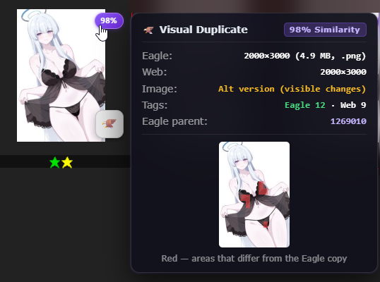
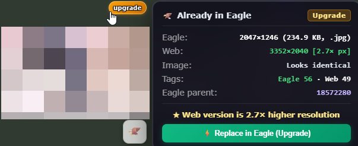
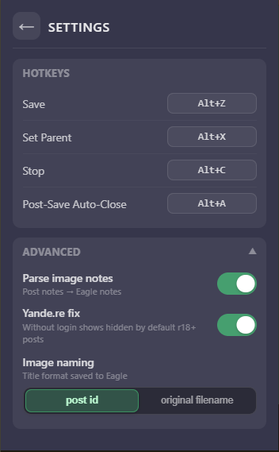

# Booru to Eagle Saver - Browser Extension

A Chromium browser extension that helps save images from Booru directly to Eagle Cool with tags, notes, etc

<strong>To Do (Notes to Self)</strong>

- Add check for user's `downloaded-db.json` exist and show a first-launch reminder/prompt
- Improve notes parsing by automatically cleaning up system junk and boilerplate text
- Speed up pHash calculations on main pages 4 `collected` and `% similarity` badges appear with lower latency
- Investigate and fix the base64 error when downloading certain videos on sankaku
- The `% similarity` mechanic doesnt fully work when an image is in the eagle trash but not yet permanently deleted - needs fixing
- Weak PC support? (primarily by lightening the sync channel with Eagle)
- Add a toggle to disable the `collected` system for users who don't need it

- Scooters

## Supported Sites

- **Danbooru**
- **Gelbooru**
- **Konachan**
- **Rule34.xxx**
- **Rule34Video**
- **Sankaku Complex** (chan.sankakucomplex fork)
- **yande.re**

<strong>Screenshots</strong>

 

<h3 align="center">Already downloaded? Know before you save</h3>

<table align="center">
  <tr>
    <td align="center" valign="top" width="50%">
       
      <b>Visual duplicate</b> — similarity badge on the thumbnail, alt-version check, tag count and parent of the Eagle copy, red blocks mark what differs
    </td>
    <td align="center" valign="top" width="50%">
       
      <b>Upgrade</b> — the web version has a higher resolution; replace the Eagle copy in one click, keeping its tags and folder
    </td>
  </tr>
</table>

<h3 align="center">Interface</h3>

<table align="center">
  <tr>
    <td align="center" valign="top">
       
      <b>Floating panel</b> on post pages: post ID, resolution, tag count, Save / Set Parent / Stop
    </td>
    <td align="center" valign="top">
       
      <b>Settings</b>: hotkeys, notes parsing, yande.re fix, image naming
    </td>
    <td align="center" valign="top">
       
      <b>Result in Eagle</b>: tags, translated notes and source link saved with the image
    </td>
  </tr>
</table>

## Installation

### Step 1: Install Eagle App

Make sure you have [Eagle](https://eagle.cool/) installed and running on your computer. The extension communicates with Eagle via its local API (localhost:41595).

### Step 2: Load the Extension

1. Open Chrome/Edge/Brave browser
2. Navigate to `//extensions/` tab
3. Enable **Developer mode** (toggle in top-right corner)
4. Click **Load unpacked**
5. Select the `extension` folder from this project
6. The extension icon should appear in your browser toolbar

### Step 3: Pin the Extension (Optional)

1. Click the puzzle piece icon in the toolbar
2. Find "Booru to Eagle Saver"
3. Click the pin icon to keep it visible

<strong>⚡Already have an Eagle library? Generate pHash Database (Optional)</strong>

If you already have images in Eagle from supported booru sites before installing or updating this extension, you can generate a perceptual hash database (`downloaded-db.json`) so the extension immediately marks all existing posts with green badges and detects visual duplicates:

#### Option 1: Automatic Script (Windows)
1. Run **`pHash_collector.bat`** in the `extension` folder after download zip from release page.
2. The batch script verifies Python and Pillow (and offers to install them automatically if missing via winget).
3. Drag and drop your Eagle library folder (e.g. `E:\MyBooruLibrary.library` or its `images` subfolder) into the console window and press **Enter**.
4. The multithreaded collector scans your library metadata, calculates 256-bit bmvbhash pHashes, and generates `downloaded-db.json` directly into the extension folder.
5. In your browser, open `chrome://extensions/` and click the **Reload** (↺) button on **Booru to Eagle Saver**.

#### Option 2: Python Command Line (Cross-platform)
1. Ensure Pillow is installed: `pip install pillow`
2. Run: `python pHash_collector.py`
3. Enter the path to your Eagle library `images` directory when prompted.
4. Reload the extension in your browser.

> **Note:** Even without running this tool, the extension automatically syncs post IDs from running Eagle in real time whenever Eagle is open. The `pHash_collector` script is only needed for instant visual duplicate comparison and indexing prior collections offline

## Usage

### On Post Pages

1. **Navigate to a supported booru site**
2. **Open an image post** — the panel appears automatically on post pages
3. **The floating panel shows:**
   - Connection status to Eagle
   - Current site name
   - Image dimensions
   - Tag count
   - Post ID (green highlight when Set Parent is active)
4. **Click "Save"** to enqueue the image with all tags

### On Main / Search Pages

1. Each thumbnail gets a **🦅 save button**
2. **Click the button** to save that post (opens hidden tab, parses, enqueues)
3. **Long-press the button** (~500ms) to set that post as the parent for subsequent saves

### Set Parent

Set Parent prepends `parent:{postId}` to all saved images, useful for grouping related saves.

### Post-Save Toggle

When enabled, the current tab closes (or navigates back) 1 second after a successful save. Synced across all tabs.

### Stop Button

Clears the save queue and aborts any in-progress downloads. Flash animation syncs across all tabs.

### Default hotkeys

| Hotkey | Action |
|--------|--------|
| `Alt+Z` | Save (only on post page) |
| `Alt+X` | Set Parent (only on post page) / Stop Parenting |
| `Alt+C` | Stop (clear queue) |
| `Alt+A` | Toggle Post-Save auto-close |

## Eagle API

This extension uses the Eagle Plugin API:
- **Endpoint**: `http://localhost:41595/api/item/addFromURL`
- **Method**: POST
- **Payload**: URL (base64 or direct), tags, website, name

Documentation: https://developer.eagle.cool/plugin-api

## License

MIT License - Feel free to modify and distribute.
